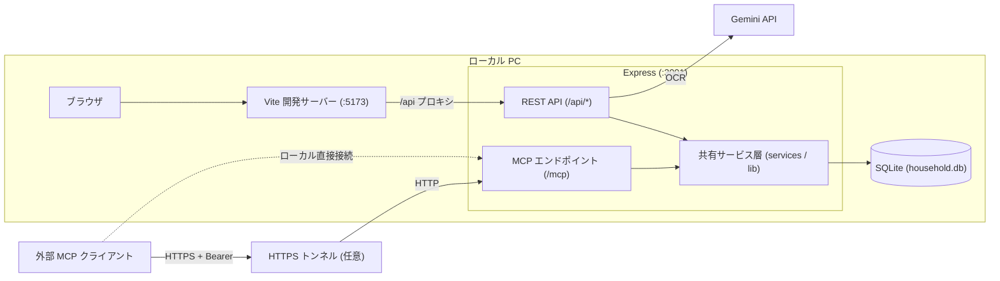
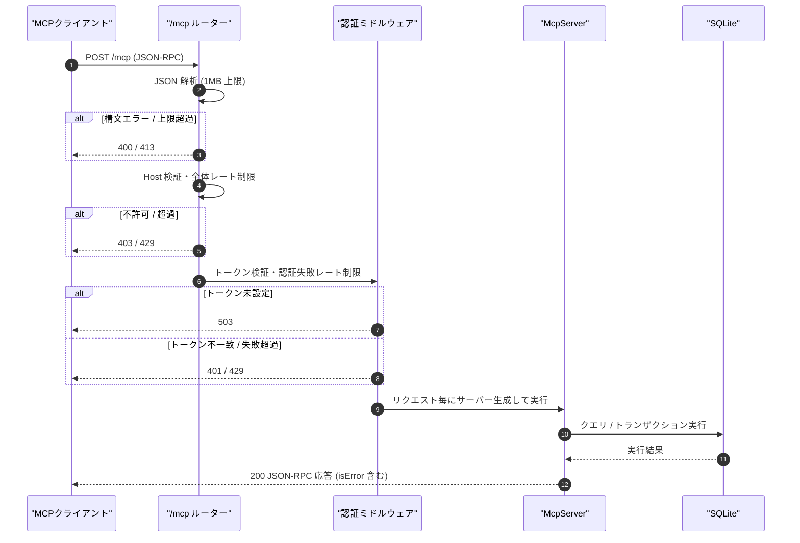
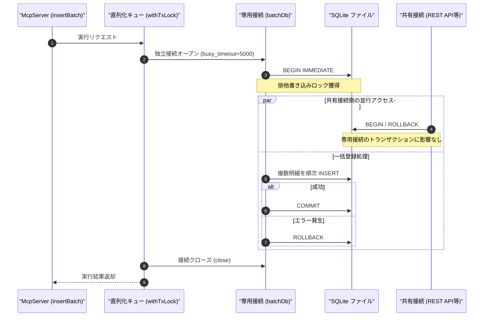

# システムアーキテクチャ

## 概要

家計簿アプリ「Gravity」は、モダンなWeb技術スタックを用いたSPA (Single Page Application) です。
フロントエンドは **Vue 3 (Vite)**、バックエンドは **Node.js (Express)**、データベースは **SQLite** を採用しています。

## 技術スタック

### フロントエンド (`/client`)

- **フレームワーク**: Vue.js 3 (Composition API, `<script setup>`)
- **ビルドツール**: Vite
- **UIスタイリング**: Tailwind CSS
- **HTTPクライアント**: Fetch API (一部 `api.js` でラップ)
- **主なコンポーネント**:
  - `TransactionForm.vue`: 家計簿入力、レシートOCR、内訳計算
  - `ReceiptOCR.vue`: Gemini APIを用いたレシート解析 (Drag & Drop, 税区分選択)
  - `ReceiptSplitter.vue`: 支払総額からの内訳計算、税額自動計算
  - `ExcelImport.vue`: バックアップ、リストア、Excel一括取込
  - `FixedCostManager.vue`: 毎月の固定入力（収入・支出）のマトリクス入力、Excelペースト対応。給与セルは合計値のみ表示し、複数明細は `salaryEntries` state で保持
  - `SalaryDetailModal.vue`: 給与セルから開く月次の給与明細モーダル。追加・編集・削除と未保存変更の破棄確認を担当
  - `YearlyAnalysis.vue`: 年次収支のグラフ・表表示

### バックエンド (`/server`)

- **ランタイム**: Node.js
- **フレームワーク**: Express.js
- **データベース**: SQLite3 (`household.db`)
- **ORM/クエリビルダ**: なし (生SQL `sqlite3` ライブラリ使用)
- **外部API**: Google Gemini API (`@google/generative-ai`) - レシートOCR用
- **依存ライブラリ**:
  - `@modelcontextprotocol/sdk`: Model Context Protocol サーバー実装 (Streamable HTTP)
  - `express-rate-limit`: API レート制限 (全体リクエスト制限および認証失敗制限)
  - `zod`: MCP 入出力バリデーションスキーマ
  - `multer`: ファイルアップロード処理
  - `csv-stringify` / `csv-parse`: CSVバックアップ・復元
  - `iconv-lite`: Shift_JIS エンコーディング対応
  - `xlsx`: Excelファイル解析

## ディレクトリ構成

```
/
├── client/                 # フロントエンド・ソースコード
│   ├── src/
│   │   ├── components/     # Vueコンポーネント
│   │   ├── api.js          # API呼び出し関数群
│   │   ├── App.vue         # メインアプリケーション
│   │   └── main.js         # エントリーポイント
│   ├── .env                # フロント環境変数 (VITE_DEV_PORT, VITE_API_PORT)
│   ├── .env.example        # .envテンプレート
│   └── vite.config.js      # Vite設定 (プロキシ設定含む)
│
├── server/                 # バックエンド・ソースコード
│   ├── mcp/                # リモート MCP サーバー
│   │   ├── index.js        # /mcp ルーター（レート制限・Host検証・認証・ハンドラ登録）
│   │   ├── auth.js         # タイミング攻撃対策 Bearer 認証ミドルウェア
│   │   ├── server.js       # McpServer インスタンス生成とツール登録
│   │   ├── schemas.js      # Zod による共通バリデーションスキーマ
│   │   ├── tools/          # ツール定義 (read.js: 参照7ツール, write.js: 更新4ツール)
│   │   └── services/       # MCP 専用サービス層 (transactions.js: 明細取得・登録・一括登録)
│   ├── services/           # REST / MCP 共有ビジネスロジックサービス層
│   │   ├── summaryService.js    # 月次サマリ・カテゴリ内訳・前月比較計算
│   │   ├── fixedCostService.js  # 年間固定費・固定収入マトリクスデータ取得
│   │   └── priceTrendService.js # キーワード価格推移・統計分析 (Jev/Simple)
│   ├── lib/                # 共通ライブラリ・ユーティリティ
│   │   ├── dbAsync.js           # SQLite 非同期 (Promise) ラッパー
│   │   ├── fiscalMonth.js       # 23日締め会計月計算ユーティリティ
│   │   ├── fixedCostCodes.js    # 固定費・給与コード定義と判定関数
│   │   ├── jevService.js        # TypeSafe AI Jev 連携
│   │   └── receiptMatcher.js    # レシートファイル照合ロジック
│   ├── routes/             # REST APIエンドポイント定義
│   │   ├── transactions.js # 家計簿CRUD
│   │   ├── fixed_costs.js  # 毎月の固定入力管理（給与複数明細を含む /api/fixed_costs/salary エンドポイント等）
│   │   ├── ocr.js          # Gemini OCR処理
│   │   ├── import.js       # Excelインポート
│   │   └── backup.js       # 全データバックアップ・復元・削除
│   ├── .env                # サーバー環境変数 (PORT, GEMINI_API_KEY, MCP_AUTH_TOKEN 等)
│   ├── .env.example        # .envテンプレート
│   ├── db.js               # SQLite接続・スキーマ定義
│   ├── app.js              # Expressアプリ設定(dotenv読込)・ルーティング登録
│   ├── household.db        # SQLiteデータベースファイル (自動生成)
│   └── uploads/            # 一時ファイル保存先
│
├── tests/                  # テストスイート
│   ├── unit/               # 単体テスト (MCP認証・参照系・更新系・計算ロジック)
│   └── e2e/                # Playwright E2E テスト
│
└── docs/                   # 開発・運用ドキュメント
```

## データフローとプロキシ

開発環境 (`npm run dev`) では、フロントエンド(Vite) とバックエンド(Express) が別ポートで動作します。
デフォルトではフロントエンドが **5173**、バックエンドが **3001** ですが、各 `.env` ファイルで変更可能です。
CORS問題を回避するため、`vite.config.js` の `server.proxy` 設定により、`/api` へのリクエストはバックエンドへ転送されます。

**リクエストフロー:**
User -> Vue App (Current View) -> `api.js` / `fetch` -> Vite Proxy -> Express Server -> SQLite DB

## データベーススキーマ (`server/db.js`)

主なテーブルは `transactions` 一つに集約されています。

### `transactions` テーブル

| カラム名        | 型      | 説明                                    |
| --------------- | ------- | --------------------------------------- |
| `id`            | INTEGER | PK, Auto Increment                      |
| `date`          | TEXT    | 取引日 (YYYY-MM-DD)                     |
| `fiscal_month`  | TEXT    | 会計月 (YYYY-MM)                        |
| `amount`        | INTEGER | 金額                                    |
| `type`          | TEXT    | 'EXPENSE' (支出) または 'INCOME' (収入) |
| `category_code` | INTEGER | カテゴリコード (例: 100=食費)           |
| `description`   | TEXT    | 品名、店名など                          |
| `memo`          | TEXT    | 備考                                    |
| `created_at`    | TEXT    | 作成日時                                |

categoriesテーブルは初期シードデータとして存在しますが、主要なデータは全て `transactions` に保存されます。

## リモート MCP アーキテクチャ

家計簿アプリ Gravity は、外部の AI クライアント（Claude Code や Cursor 等）と連携するためのリモート MCP (Model Context Protocol) サーバーをバックエンド Express 内に同居させています。

### システム構成図

クライアントからのリクエストは、Vite 開発プロキシを経由せず直接 Express の `POST /mcp` エンドポイントへ送信されます。REST API と MCP は共通のビジネスロジック層（`server/services/` および `server/lib/`）を共有し、同一の SQLite データベースを参照・更新します。



### リクエスト処理シーケンス

`/mcp` ルーターは多層防御のミドルウェアパイプラインで保護されており、リクエスト毎にステートレスな `McpServer` インスタンスを生成して処理します。



### 一括登録のトランザクション分離設計

複数明細を一括登録する `create_transactions_batch` ツールでは、全件事前検証による 100% の原子性担保に加え、既存 REST API（`fixed_costs.js` 等）との接続共有によるトランザクション衝突を防ぐため、**専用の独立 SQLite 接続**をオープンしてトランザクションを実行します。なお、`BEGIN IMMEDIATE` で書き込みロックを取得するため、トランザクション実行中は画面側等からの書き込みが最大 5 秒（busy_timeout 設定値）待機されます。



### 設計上の判断

1. **Streamable HTTP（ステートレス）の採用**:
   - MCP 公式 SDK の Streamable HTTP トランスポートを採用し、セッション ID 発行や SSE (Server-Sent Events) ストリーム維持を行わない純粋なステートレス構成（`sessionIdGenerator: undefined`、`enableJsonResponse: true`）としています。
   - これにより、サーバー再起動時でもセッション切断や再ハンドシェイクの不整合が発生せず、高い可用性とシンプルな運用性を維持できます。
2. **CORS 適用前の先行マウント**:
   - `/mcp` エンドポイントは、Express アプリケーション内で `cors()` ミドルウェアより前にマウントしています。ブラウザからの直接利用は想定しておらず、主に AI エージェント等のバックエンド・CLI クライアントからの接続を想定しています。
3. **ビジネスロジックの共有**:
   - 月次サマリ計算（`summaryService.js`）、固定費データ取得（`fixedCostService.js`）、物価分析（`priceTrendService.js`）、23日締め会計月計算（`fiscalMonth.js`）、固定費コード判定（`fixedCostCodes.js`）は独立したサービス/ライブラリ層として分離されており、REST API ルートと MCP ツール実装の両方から共通利用されています。これにより、計算ロジックや整合性ルールの二重管理を防止しています。
